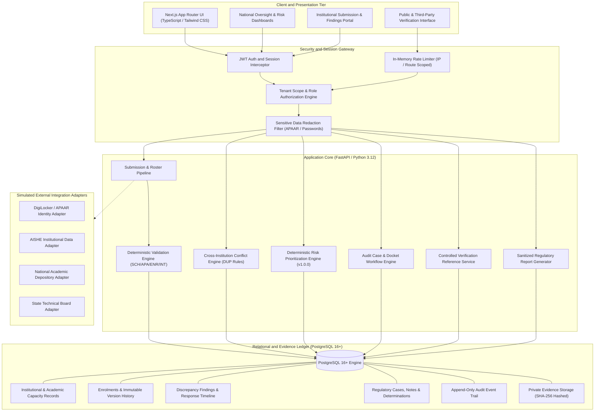
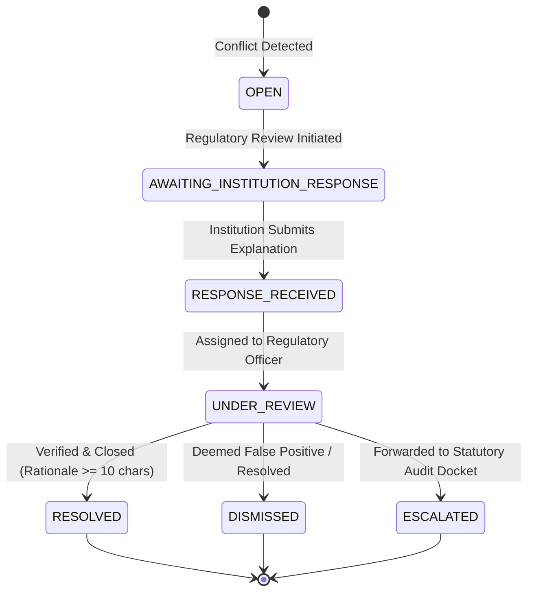
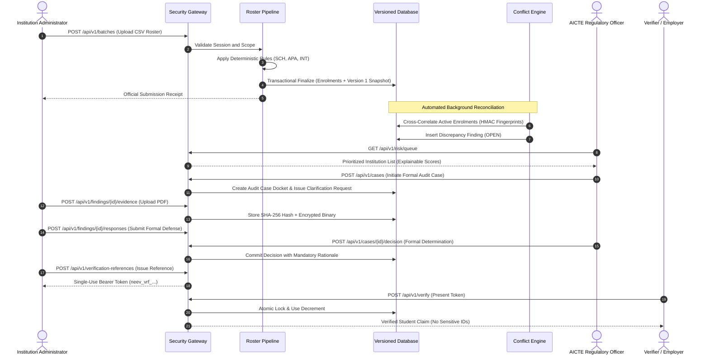

# NEEV — National Education Evidence and Verification System
> Proof Behind Every Record

NEEV is an enterprise-grade student enrolment integrity, discrepancy resolution, and regulatory monitoring platform designed for the All India Council for Technical Education (AICTE) ecosystem. It bridges institutional submissions, approved academic intake capacities, and identity validation workflows into an auditable, tamper-evident regulatory ledger.

---

## Executive Overview

### The Regulatory Challenge
Higher education regulatory authorities oversee thousands of technical and professional institutions admitting millions of students annually. Conventional regulatory reporting systems suffer from critical structural deficiencies:
* **Asynchronous Self-Reporting**: Institutions report enrolments in isolated batches without real-time cross-institutional corroboration.
* **Ghost and Duplicate Enrolments**: Students concurrently enrolled across multiple institutions or programmes remain undetected due to siloed databases and name-spelling variances.
* **Intake Ceiling Violations**: Lack of automated seat-accounting permits enrolments exceeding statutory AICTE-approved maximums.
* **Black-Box Enforcement**: Automated systems often deploy opaque heuristics or statistical models that lack legal auditability, leading to disputes and regulatory friction.
* **Identity Exposure Risks**: Direct handling of sensitive identifiers (such as APAAR or Aadhaar) across portals exposes institutional data to unauthorized aggregation and breach.

### The NEEV Approach
NEEV transforms student admissions oversight from retroactive periodic inspections into an active, evidence-backed regulatory framework:
* **Deterministic Rule Verification**: 100% explainable validation engines rejecting heuristic guesses in favor of reproducible, rule-coded verification checks.
* **Cryptographic Identity Protection**: Zero raw APAAR identifiers stored in cleartext. NEEV computes isolated HMAC-SHA256 identity fingerprints to cross-correlate enrolments without exposing student identities.
* **Immutable Versioned Ledger**: Every status update, correction, and evidence submission is versioned sequentially with optimistic concurrency control, producing a permanent audit trail.
* **Statutory Human-in-the-Loop Workflows**: Discrepancies generate structured regulatory findings governed by rigid state machines. Automated algorithms flag priority cases, while final determinations remain under authorized regulatory officer oversight.
* **Controlled Third-Party Verifications**: Purpose-bound, single-use or rate-limited verification references allowing external stakeholders (employers, certifying bodies) to verify student claims without exposing full academic files.

---

## Key Capabilities at a Glance

| Feature Domain | Traditional Portals | NEEV Regulatory Platform |
|---|---|---|
| **Intake Reconciliation** | Self-declared numbers reviewed months after admission | Real-time validation against versioned AICTE approval records |
| **Duplicate Detection** | Flawed string searches or manual complaints | Status-aware cross-institutional conflict engine with HMAC fingerprints |
| **Legitimate Student Transfers** | Flagged as violations or dual-enrolments | Status-aware transition rules (`DUP-004`) acknowledging verified transfers |
| **Data Correction Governance** | Unrestricted row editing by administrators | Immutable sequential versioning (`HIS-001`) with mandatory rationale |
| **Regulatory Risk Assessment** | Subjective inspection selection or black-box ML | 6-factor deterministic scoring (0-100) with complete factor breakdown |
| **Evidence Management** | Email attachments and unindexed paper files | SHA-256 hashed private evidence vault with tenant-scoped retrieval |
| **External Verifications** | Manual physical transcript reviews | Cryptographic bearer tokens and public verification reference codes |

---

## Core System Architecture

### Architectural Overview



---

## Primary Feature Pillars

### 1. Multi-Tenant Roster Submission and Validation Pipeline
* **Guided 4-Stage Workflow**: Context specification, CSV file ingestion, row-by-row dry-run validation, and transactional finalization.
* **Deterministic Schema & Content Rules**:
  * Rules `SCH-001` through `SCH-006`: Validates header presence, data types, date formats (ISO 8601), and mandatory institutional identifiers.
  * Rules `APA-001` through `APA-003`: Verifies 12-digit APAAR format compliance, Verhoeff checksum validity, and masked presentation standards.
  * Rule `ENR-001`: Prohibits intra-batch duplicate student identifier submissions.
* **Transactional Finalization**: Atomically commits valid rosters, issues cryptographic submission receipts, and transitions stage states without partial batch corruption.

### 2. Capacity Reconciliation and Quota Guardrails
* **Approved Intake Tracking**: Compares active student enrolments against AICTE-approved maximum capacity for every academic year, institution, and approved programme.
* **Over-Enrolment Prevention**:
  * Rule `INT-001`: Triggers a critical regulatory alert when active enrolments exceed approved intake limits.
  * Rule `INT-002`: Flags borderline utilization (95% to 100%) requiring institutional audit review.
  * Rule `INT-003`: Identifies intake anomalies across year-over-year reporting cycles.

### 3. Cross-Institution Conflict Detection Engine
* **Status-Aware Detection (`DUP-001` to `DUP-004`)**:
  * Cross-analyzes enrolments across all technical institutions in the national database.
  * Identifies dual concurrent enrolments across distinct institutions within overlapping academic years.
  * Distinguishes between fraudulent concurrent attendance and legitimate academic transfers (`DUP-004`), preventing false-positive escalations.
* **Zero Identifier Leakage**:
  * Cross-institution comparison uses Keyed HMAC-SHA256 fingerprints generated at ingestion.
  * Participating institutions never see third-party student identity registers during conflict resolution.

### 4. Immutable Enrolment Record Versioning
* **Database-Level Immutability**:
  * Every correction creates a new sequential version in `enrolment_record_versions` protected by a composite unique constraint: `(enrolment_record_id, version_number)`.
  * Captures full record JSON snapshots, acting agent ID, execution timestamp, and mandatory institutional rationale (`HIS-001`).
* **Concurrency Locking (`HIS-002`)**:
  * Requires client submissions to supply an `expected_version` parameter.
  * Rejects concurrent out-of-sequence updates, preventing conflicting overwrites.

### 5. Structured Discrepancy and Findings Lifecycle



* **Private Evidence Storage**:
  * Binary assets stored strictly in access-controlled private storage (`backend/storage/evidence/`).
  * Server-side MIME validation, 10MB file ceiling, path sanitization, and SHA-256 checksum verification.
  * Isolated endpoints preventing tenant cross-retrieval.

### 6. Explainable Regulatory Risk Engine
* **Deterministic Risk Formulation (v1.0.0)**:
  NEEV computes an explainable institutional risk priority index (0 to 100) across six statutory parameters. The calculation is 100% transparent and reproducible:

  $$\text{Total Score} = S_{\text{capacity}} + S_{\text{conflict}} + S_{\text{quality}} + S_{\text{churn}} + S_{\text{reconcile}} + S_{\text{history}}$$

  * **Intake Capacity Discrepancy** (0–25 points): Over-enrolment ratio against sanctioned AICTE quotas.
  * **Unresolved Conflicts** (0–25 points): Count and age of open cross-institution student anomalies.
  * **Data Quality Deficits** (0–15 points): Proportion of uncorroborated, missing, or malformed identifiers.
  * **Roster Churn Velocity** (0–15 points): Abnormal frequency of mid-term withdrawals, additions, or modifications.
  * **Source Reconciliation Gaps** (0–10 points): Discrepancies between institutional submissions and state board tallies.
  * **Repeat Findings Record** (0–10 points): Recurrence of systemic non-compliance over prior cycles.

* **Priority Categorization**:
  * `ROUTINE` (0–19 points): Standard monitoring; no immediate regulatory intervention.
  * `WATCH` (20–39 points): Flagged for automated trend analysis.
  * `REVIEW_RECOMMENDED` (40–59 points): Scheduled for desk review during current cycle.
  * `PRIORITY_REVIEW` (60–100 points): Immediate regulatory case docket creation.

### 7. Regulatory Case Docket and Review Management
* **Formal Audit Case Management**: Cases link canonical findings, structured clarification requests, reviewer internal notes, and institutional submissions into an authoritative legal docket.
* **Reviewer Privacy Controls**: Internal notes marked `is_internal = True` are visible solely to authorized regulatory officers and strictly stripped from institutional API responses.
* **Sanitized Reporting Center**: Generates official regulatory exports with automatic CSV formula-injection neutralization (prepends `'` to leading `=`, `+`, `-`, `@`, `\t`, or `\r` characters).

### 8. Controlled Verification References
* **Limited-Purpose Bearer Tokens**:
  * Issues cryptographically secure verification tokens (`neev_vrf_...`) linked to public reference IDs (`VRF-2026-XXXX`).
  * Plaintext bearer tokens are returned exactly once upon creation; stored at rest as SHA-256 hashes (`reference_token_hash`).
* **Atomic Use Bounds**:
  * PostgreSQL row-level locks (`SELECT ... FOR UPDATE`) prevent parallel race conditions on single-use tokens.
* **Privacy By Design**:
  * Verification responses provide claim confirmations (student name, programme, institution, verification status).
  * Raw student APAAR and identification digits are strictly withheld from verification outputs.

### 9. External Integration Transparency Center
* **Live Adapter Health Matrix**: Provides real-time status, contract probing, response latencies, and supported claims across five standard educational portals:
  * `APAAR_DIGILOCKER` (Digital Identity Provider)
  * `AISHE_PORTAL` (All India Survey on Higher Education)
  * `NAD_PORTAL` (National Academic Depository)
  * `STATE_TECH_BOARD` (State Technical Education Boards)
  * `AICTE_APPROVAL_PORTAL` (Council Approval Registers)
* **Honest Adapter Architecture**: Zero fabricated external connections. Unconfigured connections explicitly report `SIMULATED` or `UNCONFIGURED` status with mock contract probe diagnostics.

---

## Detailed Data and Evidence Flow



---

## Role-Based Access Control Matrix

The platform enforces strict role-based separation combined with database-level institutional scoping:

| Role Identifier | Description | Institutional Scope | Access Permissions |
|---|---|---|---|
| `PLATFORM_ADMIN` | System Infrastructure Engineer | Global | System health, database diagnostics, user provisioning, global configuration. |
| `AICTE_ADMIN` | Senior National Regulatory Director | National | Final decision approval, risk model management, policy reports, escalation reviews. |
| `REGULATOR_OFFICER` | Regulatory Desk Officer / Auditor | Assigned Dockets | Case reviews, clarification requests, institution risk queue inspection, report generation. |
| `INSTITUTION_ADMIN` | Registrar / Principal / Tech Dean | Single Institution | Roster submission, discrepancy responses, evidence upload, correction submissions. |
| `INSTITUTION_OPERATOR` | Admission Office Staff | Single Institution | Draft roster staging, submission status inspection, student registry searches. |
| `AUDITOR` | External Third-Party Reviewer | Read-Only Scoped | Read-only access to audit event logs and finalized case outcomes. |

---

## Technical Specifications

### Technology Stack
* **Frontend**: Next.js 14/15 (App Router, Server Components, TypeScript, Tailwind CSS, Lucide Architecture Icons).
* **Backend**: FastAPI 0.110+ (Python 3.12+), Pydantic v2 data models, dependency-injected security handlers.
* **Database & ORM**: PostgreSQL 16+ (PostgreSQL 18 production verified) accessed via SQLAlchemy 2.0 (asyncio + `asyncpg`).
* **Migrations**: Alembic with version-controlled relational revisions.
* **Security & Crypto**: Python `cryptography`, `argon2-cffi`, `python-jose` (HS256/RS256), Keyed HMAC-SHA256, SHA-256 digests.
* **Testing & Quality Assurance**: Pytest (async test client), HTTPX, Jest / TypeScript compiler verification.

### Database Engine Mandate
PostgreSQL is the sole permitted relational engine across all environments (development, testing, staging, and production). SQLite is strictly disallowed due to concurrency limitations, missing row-level locking semantics (`FOR UPDATE`), and lack of native JSONB expression support.

---

## Local Setup and Installation Guide

Follow these instructions to run a complete local instance of NEEV on Windows (PowerShell) or Linux/macOS.

### 1. Prerequisites
Ensure the following tools are installed and accessible in your system execution path:
* **Python**: Version 3.12 or newer (`python --version`)
* **Node.js**: Version 20 LTS or newer (`node --version`)
* **npm**: Version 10 or newer (`npm --version`)
* **PostgreSQL**: Version 16 or newer running locally on port 5432 (`psql --version`)

### 2. Database Initialization
Open your PostgreSQL management console or run `psql` to create the required development and testing databases:

```sql
CREATE DATABASE neev_dev;
CREATE DATABASE neev_test;
```

### 3. Environment Configuration
Copy the provided environment template to `.env` in the root directory:

```powershell
# Windows PowerShell
Copy-Item .env.example .env
```

```bash
# Linux / macOS
cp .env.example .env
```

Review `.env` and verify database connection strings match your local PostgreSQL credentials:

```env
# Database Credentials
DATABASE_URL=postgresql+asyncpg://<DB_USER>:<DB_PASSWORD>@localhost:5432/neev_dev
SYNC_DATABASE_URL=postgresql://<DB_USER>:<DB_PASSWORD>@localhost:5432/neev_dev
TEST_DATABASE_URL=postgresql+asyncpg://<DB_USER>:<DB_PASSWORD>@localhost:5432/neev_test

# Cryptographic Keys (Auto-configured defaults for local testing)
SECRET_KEY=neev-phase1-super-secret-key-change-in-production-2026-secure-token
APAAR_FINGERPRINT_KEY=neev-apaar-hmac-fingerprint-salt-key-2026
```

### 4. Backend Service Setup

```powershell
# Navigate to the backend directory
cd backend

# Create and activate Python virtual environment
# Windows PowerShell:
python -m venv venv
.\venv\Scripts\Activate.ps1

# Linux / macOS:
# python3 -m venv venv
# source venv/bin/activate

# Install backend dependencies
pip install -r requirements.txt

# Run database migrations against PostgreSQL
python -m alembic -c alembic.ini upgrade head

# Seed synthetic test institutions, programmes, and records
python -m app.seed.seed_data

# Launch the FastAPI application server
uvicorn app.main:app --reload --port 8000
```

The backend API service will initialize at `http://localhost:8000`.
* Interactive OpenAPI Docs: `http://localhost:8000/docs`
* Health Check Endpoint: `http://localhost:8000/health/live`
* Database Readiness Check: `http://localhost:8000/health/ready`

### 5. Frontend Application Setup
Open a separate terminal window:

```powershell
# Navigate to the frontend directory
cd frontend

# Install client packages
npm install

# Start the Next.js development server
npm run dev
```

The frontend application will be accessible at `http://localhost:3000`.

---

## Synthetic Demonstration Accounts

The platform includes pre-seeded demonstration accounts covering each administrative and institutional tier. All passwords conform to strict institutional complexity policies:

| Persona | Role Identifier | Synthetic Email | Initial Password | Institutional Scope |
|---|---|---|---|---|
| **AICTE National Director** | `AICTE_ADMIN` | `aicte.admin@neev.aicte.gov.in` | `NeevAdmin@2026` | National (All 3,500+ Institutions) |
| **Regulatory Audit Officer** | `REGULATOR_OFFICER` | `officer.sharma@neev.aicte.gov.in` | `RegulatorOfficer@2026` | National Reviewer Desk Scope |
| **Delhi Institute of Tech Admin** | `INSTITUTION_ADMIN` | `admin@dit.synthetic.edu.in` | `DitAdmin@2026` | Delhi Institute of Technology (`AICTE-SYNTH-1001`) |
| **Mumbai Tech University Admin** | `INSTITUTION_ADMIN` | `admin@mtu.synthetic.edu.in` | `MtuAdmin@2026` | Mumbai Tech University (`AICTE-SYNTH-2002`) |
| **Account Under Security Lock** | `INSTITUTION_ADMIN` | `disabled.user@neev.aicte.gov.in` | `DisabledUser@2026` | Inactive / Suspended (Security Test Account) |

---

## Verification and Quality Assurance Drills

### 1. Backend Automated Test Suite
Executes the full suite of 59 integration tests against an isolated PostgreSQL test database (`neev_test`):

```powershell
cd backend
.\venv\Scripts\python.exe -m pytest -v
```

### 2. Frontend Production Compilation Check
Validates TypeScript static typing, route exports, and server/client boundaries across all 23 application routes:

```powershell
cd frontend
npm run build
```

### 3. Database Backup and Restoration Drill
Executes an automated round-trip validation using `pg_dump` and `pg_restore` against a temporary target database, verifying 100% table row parity across all 39 relational tables:

```powershell
cd backend
.\venv\Scripts\python.exe ..\scripts\backup_restore_drill.py
```

---

## Repository Structure

```text
NEEV/
|-- backend/
|   |-- alembic.ini                   # Alembic database migration configuration
|   |-- requirements.txt              # Pinned backend dependency manifests
|   |-- app/
|   |   |-- main.py                   # FastAPI initialization, CORS, middleware, routing
|   |   |-- api/v1/                   # REST endpoints (auth, enrolments, cases, risk, reports)
|   |   |-- core/                     # Configuration, cryptographic utilities, security headers
|   |   |-- models/                   # SQLAlchemy 2.0 relational schema definitions (39 tables)
|   |   |-- schemas/                  # Pydantic v2 serialization and request schemas
|   |   |-- seed/                     # Deterministic synthetic test data populator
|   |   |-- services/                 # Domain logic (conflict detection, risk score, audit cases)
|   |   `-- storage/                  # Private evidence storage directory
|   |-- migrations/                   # Reversible PostgreSQL schema migration scripts
|   `-- tests/                        # Comprehensive Pytest test cases
|-- frontend/
|   |-- app/                          # Next.js App Router pages and route handlers
|   |   |-- cases/                    # Regulatory audit case docket management
|   |   |-- enrolments/               # Student enrolment registry with APAAR masking
|   |   |-- findings/                 # Discrepancy resolution and evidence review
|   |   |-- institutions/             # Institutional registry and risk profiles
|   |   |-- integrations/             # External integration transparency center
|   |   |-- overview/                 # AICTE National statutory oversight metrics
|   |   |-- reports/                  # Sanitized regulatory reporting and CSV export
|   |   |-- risk-queue/               # Explainable institutional risk review queue
|   |   |-- submissions/              # 4-stage roster upload and validation pipeline
|   |   |-- verification-references/  # Bearer token generation and lifecycle management
|   |   `-- verify/                   # Public claim verification resolver
|   |-- components/                   # Reusable UI primitives and application shells
|   `-- public/                       # Static brand assets and institutional iconography
|-- sample_data/
|   |-- valid_roster.csv              # Synthetic CSV for successful batch intake testing
|   |-- invalid_roster_with_errors.csv# Multi-error CSV for rule engine verification
|   `-- template_roster.csv           # Schema template for institutional uploads
|-- scripts/
|   `-- backup_restore_drill.py       # Automated PostgreSQL backup/restore verification script
|-- .env.example                      # Sanitized environment variable template
`-- README.md                         # Authoritative system documentation
```

---

## Regulatory and Security Disclaimers

1. **Synthetic Data Classification**: All data, student names, APAAR identifiers, and institutional credentials bundled within this repository are entirely synthetic demonstration artefacts created solely for software testing and evaluation purposes.
2. **Adapter Declaration**: External integration modules (APAAR/DigiLocker, AISHE, NAD, State Boards) run as simulated mock adapters. The system makes no claim of active authorized live connections to protected Government of India databases.
3. **Data Protection Principle**: NEEV is engineered to comply with national digital personal data protection standards. Production deployment requires independent statutory clearance, cryptographic HSM key management, and authorized governmental hosting.
