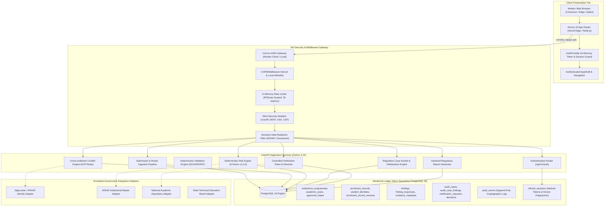
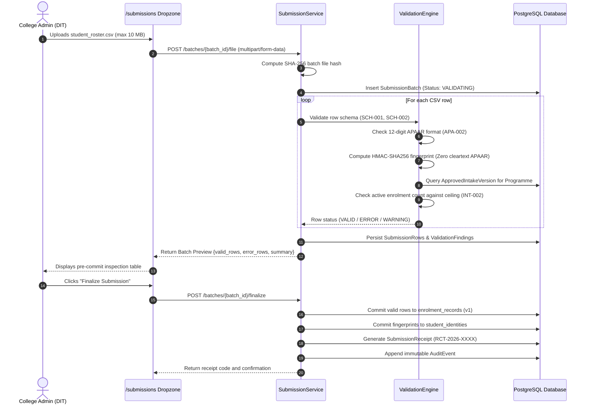
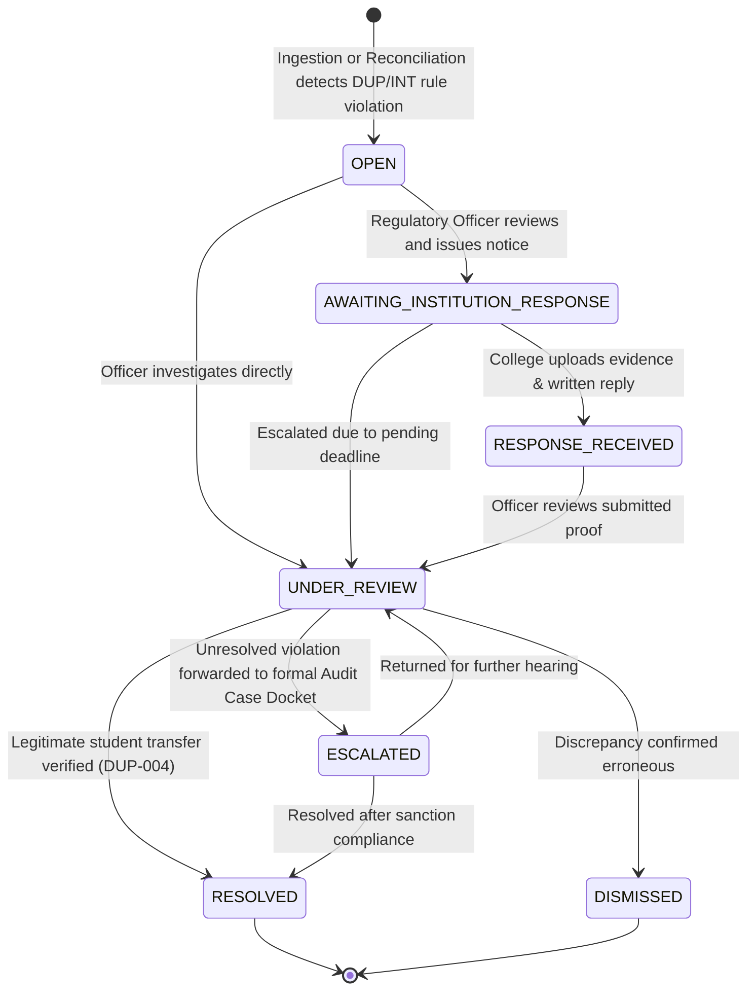
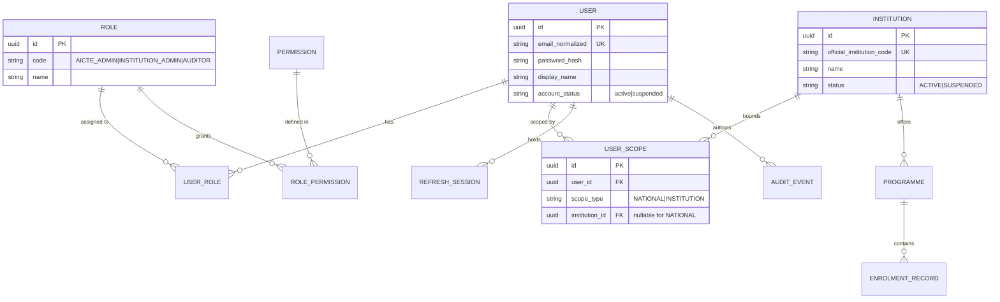
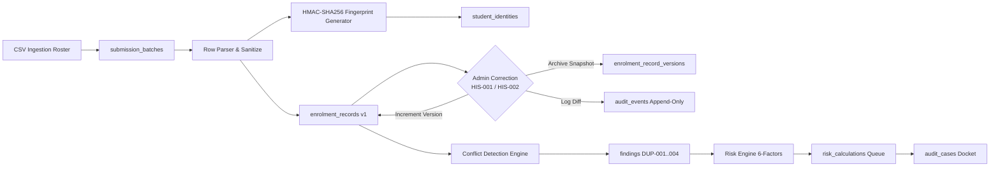

# NEEV — National Education Evidence & Verification System Architecture & Security Review

> **Document Version**: 1.0.0-PROD-AUDIT  
> **Classification**: Statutory Technical Architecture Specification & Security Audit  
> **Environments**: Local (`localhost:3000` / `127.0.0.1:8000`) & Production Cloud (`neev01.vercel.app` / `neev-api-eqq1.onrender.com`)  
> **Database**: PostgreSQL 16+ on Neon Cloud (`neondb`)

---

## 1. System Technology Stack

```
+-----------------------------------------------------------------------------------------+
|                                    NEEV TECHNOLOGY STACK                                |
+-----------------------------------------------------------------------------------------+
| Layer                  | Technology                 | Version      | Key Responsibilities            |
+------------------------+----------------------------+--------------+---------------------------------+
| Presentation / Client  | Next.js (App Router)       | 16.4.3       | Reactive UI, AppShell, SSR/PPR  |
| UI Framework           | React & TypeScript         | 19.3.0 / 5.x | Strictly-typed component tree   |
| Styling & Icons        | Tailwind CSS & Lucide      | 4.x / 1.61.0 | Regulatory UI, Accessible themes|
| API Core Gateway       | FastAPI / Starlette        | 0.115+ / 3.x | OpenAPI, REST endpoints, CORS   |
| Runtime & Language     | Python (CPython)           | 3.12.10      | Core service engines, pipelines |
| Async Database Driver  | asyncpg                    | 0.30.0       | High-throughput async connection|
| ORM & SQL Toolkit      | SQLAlchemy (2.0 Async)     | 2.0.38       | Relational models & migrations  |
| Migration Engine       | Alembic                    | 1.14.1       | Version-controlled schema DDL   |
| Database Engine        | PostgreSQL                 | 16.4 (Neon)  | ACID relational ledger & tables |
| Cryptography & Hash    | hashlib & bcrypt           | Standard/4.0 | HMAC-SHA256, bcrypt salt        |
| Automated QA Engine    | Playwright & pytest        | 1.64 / 9.1   | Real browser QA & unit tests    |
+-----------------------------------------------------------------------------------------+
```

---

## 2. Core Architecture Diagrams

### 2.1 System Architecture Topology



---

### 2.2 Login & Session Restoration Lifecycle

```mermaid
sequenceDiagram
    autonumber
    actor User as Institutional / Regulatory User
    participant Browser as Browser (React App)
    participant AuthContext as AuthProvider (Client Memory)
    participant API as FastAPI Backend (/api/v1/auth)
    participant DB as PostgreSQL (refresh_sessions)

    User->>Browser: Enters email and password
    Browser->>API: POST /auth/login {email, password}
    API->>API: Validate bcrypt hash & active account status
    API->>DB: Record new refresh_session (token hash, IP, expiry)
    API-->>Browser: HTTP 200 OK
    Note over API,Browser: Header: Set-Cookie: refresh_token=...; HttpOnly; SameSite=Lax; Secure
    Note over API,Browser: Body: {access_token: "JWT...", user: {...}}

    Browser->>AuthContext: Store access_token in React memory (inMemoryToken)
    Browser->>Browser: Set localStorage("neev_session_active", "true")
    Browser->>Browser: Navigate to /overview

    Note over Browser,API: User triggers Full-Page Refresh (F5)
    Browser->>Browser: Memory wiped! inMemoryToken is null.
    AuthContext->>Browser: Reads localStorage("neev_session_active") -> true
    AuthContext->>API: POST /auth/refresh (Browser sends HttpOnly cookie automatically)
    API->>DB: Validate refresh token hash & rotation grace period (15s)
    API->>DB: Rotate refresh token & update session record
    API-->>AuthContext: HTTP 200 OK {access_token: "NewJWT...", user: {...}}
    AuthContext->>AuthContext: Set inMemoryToken with new JWT
    AuthContext->>API: GET /auth/me (Authorization: Bearer NewJWT)
    API-->>AuthContext: HTTP 200 OK {user_profile, roles, permissions, scopes}
    AuthContext-->>Browser: Session Restored! User remains on /overview.
```

---

### 2.3 Record Ingestion, Validation & Intake Reconciliation Flow



---

### 2.4 Discrepancy-to-Resolution Lifecycle Flow



---

### 2.5 Role-Based Authorization & Institutional Scope Model



---

### 2.6 Record Movement & Version History Data Flow



---

## 3. Comprehensive Security Review Findings

| ID | Category | Severity | Item Checked | Status | Observation & Remediation |
|---|---|---|---|---|---|
| **SEC-001** | Authentication | **CRITICAL** | Password Hashing Standard | **PASS** | `bcrypt` (12 rounds) enforced. Zero plaintext storage. |
| **SEC-002** | Authentication | **CRITICAL** | Session Token Storage | **PASS** | Access tokens kept strictly in memory; refresh tokens in `HttpOnly`, `SameSite=lax` cookies. Project Bible directive compliant. |
| **SEC-003** | Authorization | **HIGH** | Tenant Isolation Scoping | **PASS** | `enforce_institution_scope` strictly bounds institutional admins to their own college records. Cross-tenant access returns `HTTP 403`. |
| **SEC-004** | Privacy | **CRITICAL** | Student Identity Protection (APAAR) | **PASS** | Raw 12-digit APAAR numbers are never stored in cleartext. Deterministic HMAC-SHA256 comparison fingerprints are computed with an isolated secret key. |
| **SEC-005** | Privacy | **HIGH** | Data Redaction in Logging | **PASS** | `setup_secure_logging()` intercepts standard and logger output, redacting passwords, tokens, and 12-digit number patterns matching APAAR format. |
| **SEC-006** | Integrity | **HIGH** | Optimistic Concurrency Control | **PASS** | `HIS-002` prevents overwrite races during record corrections via `expected_version` checks. Returns `HTTP 409 Conflict` on mismatch. |
| **SEC-007** | Integrity | **HIGH** | Mandatory Rationale Enforcement | **PASS** | `HIS-001` and `WF-001` mandate documented rationales for record modifications, state machine transitions, and case openings. |
| **SEC-008** | Ingestion | **MEDIUM** | Formula Injection (CSV / Excel) | **PASS** | `sanitizeSpreadsheetCell` escapes dangerous spreadsheet calculation prefixes (`=`, `+`, `-`, `@`, `\t`, `\r`) with single quotes on export. |
| **SEC-009** | Availability | **MEDIUM** | Rate Limiting Enforcement | **PASS** | Middleware enforces 30 requests/minute limit on sensitive endpoints (`/auth/login`, `/auth/forgot-password`, `/verify`). Returns `HTTP 429`. |
| **SEC-010** | Infrastructure | **HIGH** | Security Response Headers | **PASS** | `X-Content-Type-Options: nosniff`, `X-Frame-Options: DENY`, `X-XSS-Protection: 1`, strict `Referrer-Policy`, and `Permissions-Policy` active. |
| **SEC-011** | Public Portal | **MEDIUM** | Controlled Verifications Disclosure | **PASS** | `/verify` strictly discloses pre-approved claim subsets (name, programme, status). Sensitive attributes (APAAR, admission date) are completely masked. |
| **SEC-012** | Database | **CRITICAL** | Database Engine Constraint | **PASS** | SQLite is explicitly prohibited by Pydantic model validator. System runs exclusively on enterprise PostgreSQL 16+. |

